# Documento de Design

## Overview

A **Sophia** é um chatbot web que auxilia o Usuário a analisar perfis do LinkedIn. Toda a inteligência da análise (apresentação, reconhecimento de Seções, verificação de critérios, cálculo da Pontuação_de_Qualidade, geração de Recomendações, composição do Relatório_de_Análise, perguntas de acompanhamento, reanálise e mensagens de privacidade) é conduzida **conversacionalmente pelo modelo de linguagem** do Amazon Bedrock, orientado por uma instrução central (`SYSTEM_PROMPT`).

O sistema segue a stack obrigatória do projeto: uma aplicação **Flask** mínima, com `app.py` na raiz e a página em `templates/index.html`. A comunicação com o navegador acontece por duas rotas:

- `GET /` — entrega a página de chat.
- `POST /chat` — recebe `{"message": "..."}` e devolve `{"reply": "..."}`.

As respostas são geradas pelo Amazon Bedrock (`bedrock-runtime`, `invoke_model`, região `us-east-1`), usando o modelo `us.anthropic.claude-haiku-4-5-20251001-v1:0`. As credenciais AWS são lidas exclusivamente de variáveis de ambiente.

### Decisão de design central

Os requisitos descrevem um "Analisador" com regras objetivas (mínimo de 40 palavras no resumo, pelo menos 5 competências, pontuação de 0 a 100, ordenação de Recomendações por impacto etc.). Dentro das restrições da stack — projeto mínimo, sem banco de dados, sem bibliotecas adicionais de IA, sem RAG — **o Analisador não é um módulo de código determinístico; ele é descrito em linguagem natural dentro do `SYSTEM_PROMPT`** e executado pelo modelo. O papel do código Flask é somente:

1. Servir a página.
2. Receber cada mensagem, validá-la (mensagem vazia → HTTP 400).
3. Montar o contexto da conversa (`SYSTEM_PROMPT` + histórico da Sessão + nova mensagem).
4. Chamar o Bedrock e devolver a resposta.
5. Manter o histórico da Sessão no lado do cliente para preservar o contexto do Perfil ao longo da conversa.

Essa decisão mantém o projeto didático e com poucos arquivos, concentrando as regras de negócio num único lugar legível (o `SYSTEM_PROMPT`).

## Architecture

### Visão geral dos componentes

```mermaid
flowchart LR
    U[Usuário / Navegador] -->|GET /| P[Flask: página index.html]
    U -->|POST /chat {message, history}| C[Flask: rota /chat]
    C -->|valida mensagem| V{Mensagem vazia?}
    V -->|sim| E400[HTTP 400]
    V -->|não| B[Monta payload: SYSTEM_PROMPT + histórico + mensagem]
    B --> BR[Amazon Bedrock invoke_model\nclaude-haiku-4-5]
    BR -->|texto da resposta| R[reply]
    R -->|JSON ensure_ascii=False| U
```

### Fluxo de uma requisição `/chat`

```mermaid
sequenceDiagram
    participant Nav as Navegador
    participant App as app.py (Flask)
    participant Bed as Bedrock Runtime

    Nav->>App: POST /chat {message, history}
    App->>App: valida message (vazia -> 400)
    App->>App: monta messages = history + {role:user, content:message}
    App->>Bed: invoke_model(systemPrompt=SYSTEM_PROMPT, messages)
    alt chamada bem-sucedida
        Bed-->>App: resposta do modelo (texto)
        App-->>Nav: 200 {"reply": texto}
    else falha no Bedrock
        Bed-->>App: exceção
        App-->>Nav: 200 {"reply": mensagem de erro amigável}
    end
    Nav->>Nav: anexa pergunta e resposta ao histórico local
```



### Gestão de Sessão e contexto

O requisito de manter o contexto do Perfil durante a Sessão (Requirements 2.4, 7.3, 8.1) e de **não reter dados após o encerramento** (Requirement 10) é atendido mantendo o histórico da conversa **no navegador** (memória da página, em JavaScript) e reenviando-o a cada chamada `/chat`:

- O servidor Flask permanece **stateless**: não grava Perfil em disco nem em banco (proibido no projeto) e não usa sessões persistentes do lado do servidor.
- O histórico vive apenas na página aberta. Ao fechar/recarregar a página, os dados do Perfil deixam de existir — satisfazendo "não reter dados após o encerramento da Sessão" de forma natural e sem armazenamento.
- A "exclusão de dados a pedido" (Requirement 10.3) é tratada no cliente limpando o histórico em memória, e a Sophia confirma o descarte na conversa (orientada pelo `SYSTEM_PROMPT`).

Essa abordagem é a mais simples compatível com as restrições (sem banco, sem login, poucos arquivos) e alinha o ciclo de vida dos dados ao ciclo de vida da página.

## Components and Interfaces

### 1. `app.py` (raiz)

Arquivo único com a aplicação Flask. Responsabilidades:

- Definir a constante `SYSTEM_PROMPT` com a personalidade, o tom, os limites e **todas as regras de análise da Sophia** (ver seção "Mapeamento dos requisitos para o SYSTEM_PROMPT").
- Configurar `app.json.ensure_ascii = False` para JSON com acentos legíveis.
- Criar o cliente Bedrock via `boto3.client("bedrock-runtime", region_name="us-east-1")`, usando credenciais de variáveis de ambiente.
- Expor as rotas `/` e `/chat`.
- Encapsular a chamada ao modelo numa função auxiliar (por exemplo `gerar_resposta(mensagem, historico)`).

#### Rota `GET /`

- Entrada: nenhuma.
- Saída: renderiza `templates/index.html`.

#### Rota `POST /chat`

- Entrada (JSON): `{"message": "<texto do usuário>", "history": [...]}`
  - `message` (string, obrigatório): texto enviado pelo Usuário.
  - `history` (lista, opcional): mensagens anteriores da Sessão, no formato de turnos `{"role": "user"|"assistant", "content": "..."}`. Permite manter o contexto do Perfil sem estado no servidor.
- Validação: se `message` estiver ausente ou for uma string vazia, responder **HTTP 400** (conforme a stack obrigatória).
- Saída (JSON): `{"reply": "<resposta da Sophia>"}` com `ensure_ascii = False`.
- Erros do Bedrock: capturados e convertidos em uma `reply` amigável (ver "Error Handling"), sem derrubar a Sessão (Requirements 9.3, 9.4).

#### Função `gerar_resposta(mensagem, historico)`

- Monta a lista de mensagens no formato esperado pela API Messages do Anthropic no Bedrock: concatena o `historico` recebido e acrescenta o turno atual do Usuário.
- Monta o corpo do `invoke_model` com:
  - `anthropic_version`
  - `system`: a constante `SYSTEM_PROMPT`
  - `messages`: histórico + mensagem atual
  - `max_tokens` e `temperature` adequados a respostas analíticas e consistentes.
- Chama `bedrock_runtime.invoke_model(modelId="us.anthropic.claude-haiku-4-5-20251001-v1:0", body=...)`.
- Lê o corpo da resposta, extrai o texto gerado e o devolve.

### 2. `templates/index.html`

Página de chat mínima com:

- Área de histórico de mensagens.
- Campo de entrada e botão de envio.
- JavaScript que:
  - Mantém o array `history` em memória (contexto da Sessão).
  - Envia `POST /chat` com `message` e `history`.
  - Ao receber `reply`, anexa a pergunta e a resposta ao `history` e às mensagens exibidas.
  - Trata o HTTP 400 exibindo um aviso de "mensagem vazia".
  - Oferece uma ação de "limpar conversa" que zera o `history` local (apoia o descarte de dados a pedido — Requirement 10.3).

### 3. `requirements.txt`

Somente `flask` e `boto3`.

### Mapeamento dos requisitos para o `SYSTEM_PROMPT`

Como o Analisador é conversacional, o `SYSTEM_PROMPT` codifica, em linguagem natural, as regras de cada requisito. O quadro abaixo mostra como cada requisito se materializa nas instruções do prompt (e, onde aplicável, no código Flask ou no cliente).

| Requisito | Onde é tratado | Instrução/comportamento |
|---|---|---|
| R1 Apresentação | SYSTEM_PROMPT | Na primeira mensagem da Sessão, apresentar-se como "Sophia", listar nominalmente as Seções analisáveis (Título/Headline, Sobre/Resumo, Experiência, Competências) e pedir a Entrada_de_Perfil. Se a 1ª mensagem não for um perfil, apresentar-se e reiterar o pedido sem iniciar análise. |
| R2 Recebimento da entrada | SYSTEM_PROMPT + histórico no cliente | Identificar as Seções presentes; se vazia, pedir conteúdo mantendo Seções já acumuladas; se faltar Seção obrigatória (título, resumo, experiência), nomear as ausentes; acumular Seções entre mensagens, substituindo quando a mesma Seção for reenviada; iniciar a análise quando todas as obrigatórias existirem. O acúmulo se dá pelo reenvio do `history`. |
| R3 Análise das Seções | SYSTEM_PROMPT | Regras explícitas: completude por campos; título com ≥1 termo de cargo/área (lista de referência embutida no prompt); resumo com ≥40 palavras; cada experiência com cargo+organização+período; competências ≥5; status "bom"/"precisa melhorar"; Seção ausente/vazia → "precisa melhorar" sem interromper as demais. |
| R4 Pontuação de qualidade | SYSTEM_PROMPT | Pontuação geral inteira de 0 a 100 e pontuação por Seção (0 a 100); explicar o critério usado por Seção; se nenhuma Seção fornecida, informar e não calcular. |
| R5 Recomendações | SYSTEM_PROMPT | Gerar ≥1 Recomendação por critério não atendido; ordenar por impacto decrescente na pontuação; desempate pela ordem das Seções no perfil; Seção sem deficiência → declarar que atende a todos os critérios; cada Recomendação com ação executável e o critério alvo. |
| R6 Relatório consolidado | SYSTEM_PROMPT + histórico | Compor o Relatório_de_Análise numa única resposta (pontuação + avaliação por Seção + Recomendações); se sem Recomendações, declará-lo; reapresentar o Relatório quando pedido na Sessão (usando o histórico); se pedido antes de existir, informar que a análise não foi concluída. |
| R7 Acompanhamento | SYSTEM_PROMPT + histórico | Responder perguntas usando a Recomendação e a avaliação da Seção registradas no histórico; fornecer exemplo reescrito que atenda aos critérios; manter contexto via histórico; se perguntado antes do Relatório, informar e pedir a Entrada_de_Perfil preservando o já recebido. |
| R8 Reanálise | SYSTEM_PROMPT + histórico | Substituir integralmente a Seção atualizada; atualização vazia → manter conteúdo anterior e avisar; recalcular pontuação sobre as Seções atuais; compor novo Relatório; mostrar a variação vs. pontuação anterior (aumento/redução/igual); sem pontuação anterior, apresentar só a nova e avisar que não há comparação. |
| R9 Entradas inválidas | SYSTEM_PROMPT + Error Handling | Conteúdo sem Seção reconhecível → avisar que não parece um perfil e pedir reenvio; mensagem fora do escopo → informar que atua só em análise de perfil; falha de processamento → avisar que a análise não concluiu e pedir reenvio, preservando o recebido (ver Error Handling). |
| R10 Privacidade | SYSTEM_PROMPT + cliente stateless | Ao iniciar a Sessão, informar que os dados são usados só na Sessão atual e não são retidos; descarte a pedido limpa o histórico local e a Sophia confirma; servidor não persiste nada; dados vivem apenas na página aberta. |

## Data Models

O sistema não usa banco de dados. Os "modelos" são estruturas leves em trânsito (JSON na requisição/resposta) e conceituais (mantidos pelo modelo via histórico).

### Requisição `/chat` (navegador → servidor)

```json
{
  "message": "string, texto do usuário",
  "history": [
    {"role": "user", "content": "mensagem anterior do usuário"},
    {"role": "assistant", "content": "resposta anterior da Sophia"}
  ]
}
```

### Resposta `/chat` (servidor → navegador)

```json
{ "reply": "string, resposta da Sophia (com acentos legíveis)" }
```

### Resposta de erro de validação

- Mensagem vazia → **HTTP 400** com um corpo JSON simples, por exemplo `{"error": "mensagem vazia"}`.

### Modelos conceituais mantidos pelo modelo (não persistidos)

Estas entidades não existem como tabelas ou classes; são conceitos que o `SYSTEM_PROMPT` instrui o modelo a manter e raciocinar a partir do histórico da Sessão:

- **Seção**: rótulo (título/headline, sobre/resumo, experiência, formação, competências) + conteúdo textual + status ("bom" | "precisa melhorar") + pontuação (0–100).
- **Perfil**: conjunto de Seções acumuladas na Sessão (representado pelo histórico reenviado).
- **Recomendação**: Seção alvo + critério não atendido + ação executável + impacto estimado na pontuação (usado para ordenação).
- **Relatório_de_Análise**: Pontuação_de_Qualidade geral + avaliação por Seção + lista ordenada de Recomendações.
- **Pontuação_de_Qualidade anterior**: valor da análise prévia na Sessão, preservado no histórico para o cálculo da variação na reanálise (R8.5/R8.6).

## Error Handling

O tratamento de erros é mínimo e orientado a manter a Sessão viva (Requirements 9.3, 9.4).

| Situação | Tratamento |
|---|---|
| `message` ausente ou vazia | Retornar **HTTP 400** imediatamente, sem chamar o Bedrock (regra da stack). |
| Corpo JSON malformado na requisição | Retornar HTTP 400 com mensagem explicativa. |
| Falha na chamada ao Bedrock (exceção `boto3`/`ClientError`, timeout, throttling) | Capturar a exceção e devolver **HTTP 200** com uma `reply` amigável informando que a análise não foi concluída e pedindo para reenviar a Entrada_de_Perfil (R9.3). O servidor não encerra a Sessão; o `history` do cliente é preservado (R9.4). |
| Credenciais AWS ausentes/ inválidas | Tratar como falha do Bedrock: `reply` amigável de indisponibilidade. As credenciais vêm apenas de variáveis de ambiente; nunca são escritas no código. |
| Conteúdo fora do escopo ou não reconhecível como perfil (R9.1, R9.2) | Não é erro técnico: o modelo responde conforme o `SYSTEM_PROMPT`, orientando o Usuário a enviar um perfil. |

Observações:

- Os comentários do código explicam, em português, cada bloco de tratamento (estilo didático).
- Nenhuma mensagem de erro expõe detalhes internos, chaves ou stack traces ao Usuário.

## Testing Strategy

### Avaliação de aplicabilidade de Property-Based Testing (PBT)

**PBT não é apropriado para esta feature.** Justificativa:

1. **O projeto proíbe explicitamente testes automatizados** (regra de steering: "Não criar testes automatizados"). Essa restrição prevalece sobre a inclusão de qualquer suíte de testes, incluindo PBT.
2. **Não existe função pura com entrada/saída determinística no nosso código.** A lógica do Analisador (reconhecer Seções, verificar critérios, pontuar, recomendar) é executada pelo **modelo de linguagem** do Bedrock, cuja saída é textual e não determinística. Não há como escrever uma afirmação "para todo input X, a propriedade P(X) vale" sobre um comportamento gerado por LLM.
3. O código Flask em si só faz **roteamento, validação e orquestração de I/O** (chamada ao Bedrock), que são justamente os casos em que PBT não se aplica (operações de I/O e integração com serviço externo).

Portanto, **a seção "Correctness Properties" é omitida** deste design, e o `prework` de propriedades não é executado.

### Estratégia de validação adotada (manual, sem automação)

Como não há testes automatizados, a validação é feita de forma manual e exploratória, rodando a aplicação com `python app.py` em `localhost:5000` e conversando com a Sophia:

- **Validação de contrato das rotas**: confirmar que `GET /` entrega a página e que `POST /chat` com mensagem vazia retorna HTTP 400, enquanto uma mensagem válida retorna `{"reply": ...}` com acentos legíveis.
- **Roteiros conversacionais manuais** cobrindo os requisitos-chave:
  - Primeira mensagem → apresentação + lista de Seções + pedido de perfil (R1).
  - Envio de perfil em partes → acúmulo e pedido das Seções obrigatórias ausentes (R2).
  - Perfil completo → Relatório com pontuação geral, pontuação por Seção e critérios (R3, R4, R6).
  - Recomendações ordenadas por impacto e com ações executáveis (R5).
  - Perguntas de acompanhamento e pedido de exemplo reescrito (R7).
  - Atualização de uma Seção e nova análise com variação de pontuação (R8).
  - Entradas fora de escopo e conteúdo não reconhecível como perfil (R9).
  - Mensagem de privacidade no início e descarte de dados ("limpar conversa") (R10).
- **Verificação de privacidade/stateless**: recarregar a página e confirmar que o contexto do Perfil desapareceu (nenhum dado retido no servidor).
- **Verificação de resiliência**: simular indisponibilidade do Bedrock (por exemplo, credenciais ausentes) e confirmar que a Sophia responde com mensagem amigável e a Sessão continua utilizável (R9.3, R9.4).

Essas verificações manuais são suficientes e proporcionais a um projeto mínimo e didático, respeitando a proibição de testes automatizados.
