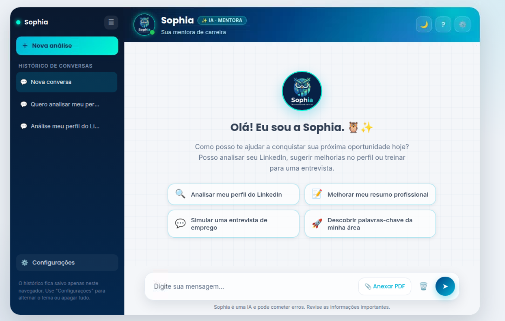

# Sophia — Mentora de Carreira e Analisadora de Perfis do LinkedIn

Sophia é um chatbot web que analisa perfis do LinkedIn (ou currículos em PDF)
e devolve um feedback crítico e acionável: pontuação de qualidade, avaliação
seção por seção e recomendações de melhoria. As respostas são geradas pelo
**Amazon Bedrock** (modelo Claude Haiku) e a interface é um app de chat moderno,
com tema claro/escuro e histórico de conversas.

> Projeto mínimo e didático: poucos arquivos, código comentado em português,
> Flask no backend e HTML/CSS/JS puro no frontend (sem frameworks).

---

## 🎬 Demonstração

### Tela inicial



### Vídeo da aplicação em execução

https://github.com/user-attachments/assets/023d6ab5-17c5-4354-8348-0b0dcbd7f8dc

<!--
  Como adicionar as mídias:

  1) PRINT da tela inicial
     - Salve a imagem em: docs/media/tela-inicial.png
     - O caminho acima já aponta para ela.

  2) VÍDEO da aplicação
     Opção A (recomendada — sem pesar o repositório):
       - Abra o GitHub > issue/PR ou a área de edição do README e ARRASTE o
         arquivo de vídeo (.mp4/.mov). O GitHub gera um link
         https://github.com/user-attachments/... Cole esse link no lugar acima.
     Opção B (vídeo versionado no repositório):
       - Salve em docs/media/demo.mp4 e use um link clicável:
         [▶ Assistir ao vídeo](docs/media/demo.mp4)
       - Evite vídeos grandes no Git; prefira a Opção A.
-->

---

## ✨ Funcionalidades

- **Análise de perfil do LinkedIn** a partir de texto colado ou de um **PDF**
  de currículo (o texto é extraído automaticamente).
- **Relatório crítico**: pontuação geral (0–100), pontuação por seção, avaliação
  visual "na visão do recrutador" e recomendações ordenadas por impacto.
- **Interface moderna**: onboarding com cards de sugestão, balões de chat,
  indicador "Sophia está digitando" e efeito glassmorphism.
- **Tema claro/escuro** com preferência salva no navegador.
- **Histórico de conversas** guardado localmente (localStorage): criar, trocar
  e excluir conversas; o contexto é re-sincronizado com o servidor ao trocar.
- **Respostas formatadas**: o Markdown da Sophia é convertido em HTML de forma
  segura (títulos, listas, negrito, links), sem risco de injeção.
- **Privacidade por padrão**: os dados do perfil são usados só na conversa atual
  e podem ser descartados a qualquer momento.

---

## 🧱 Stack

| Camada    | Tecnologia                                             |
| --------- | ------------------------------------------------------ |
| Backend   | Python + Flask                                         |
| IA        | Amazon Bedrock (`bedrock-runtime`, `invoke_model`)     |
| Modelo    | `us.anthropic.claude-haiku-4-5-20251001-v1:0`          |
| SDK AWS   | boto3                                                  |
| PDF       | pypdf                                                  |
| Frontend  | HTML + CSS + JavaScript puro (Jinja2 via Flask)        |

---

## 📁 Estrutura do projeto

```
meu-chatbot/
├── app.py                  # Aplicação Flask: rotas, SYSTEM_PROMPT e chamada ao Bedrock
├── requirements.txt        # Dependências (flask, boto3, pypdf)
├── .env.example            # Modelo das variáveis de ambiente (sem segredos)
├── .gitignore
├── README.md
├── templates/
│   └── index.html          # Interface do chat (UI + CSS + JS)
├── static/
│   └── sophia-logo.jpeg    # Avatar/logo da Sophia
└── docs/                   # Material de referência (não faz parte do runtime)
    ├── identidade-visual.md
    ├── logo-sophia-referencia.jpeg
    └── mockup-referencia.png
```

---

## ⚙️ Pré-requisitos

- Python 3.10 ou superior.
- Uma conta AWS com **acesso ao Amazon Bedrock** na região `us-east-1` e com o
  modelo Claude Haiku habilitado.
- Credenciais da AWS com permissão para `bedrock:InvokeModel`.

---

## 🚀 Como rodar

### 1. Clonar o repositório

```bash
git clone <url-do-seu-repositorio>
cd meu-chatbot
```

### 2. Criar e ativar o ambiente virtual

```bash
python -m venv venv
source venv/bin/activate      # Linux/macOS
# venv\Scripts\activate       # Windows (PowerShell)
```

### 3. Instalar as dependências

```bash
pip install -r requirements.txt
```

### 4. Configurar as credenciais da AWS

As credenciais são lidas **somente do ambiente** — nenhuma chave fica no código.
Copie o arquivo de exemplo e preencha com os seus valores:

```bash
cp .env.example .env
```

Depois exporte as variáveis no seu terminal (ou use uma ferramenta como
`python-dotenv` / `direnv`, se preferir):

```bash
export AWS_ACCESS_KEY_ID="sua_access_key"
export AWS_SECRET_ACCESS_KEY="sua_secret_key"
export AWS_DEFAULT_REGION="us-east-1"
```

### 5. Iniciar a aplicação

```bash
python app.py
```

Acesse **http://localhost:5000** no navegador.

---

## 🔌 Rotas da API

| Método | Rota           | Descrição                                                             |
| ------ | -------------- | --------------------------------------------------------------------- |
| GET    | `/`            | Serve a página de chat.                                               |
| POST   | `/chat`        | Recebe a mensagem (`{"message": "..."}`) ou um PDF e devolve `{"reply": "..."}`. Mensagem vazia retorna **400**. |
| POST   | `/limpar`      | Descarta a memória de conversa guardada no servidor.                  |
| POST   | `/sincronizar` | Substitui a memória do servidor pelo contexto da conversa escolhida.  |

Exemplo de chamada ao `/chat`:

```bash
curl -X POST http://localhost:5000/chat \
  -H "Content-Type: application/json" \
  -d '{"message": "Olá, Sophia!"}'
```

---

## 🔒 Privacidade e segurança

- Nenhuma credencial da AWS é escrita no código; tudo vem de variáveis de ambiente.
- O arquivo `.env` é ignorado pelo Git (veja `.gitignore`).
- O histórico de conversas vive no **navegador** (localStorage) e pode ser
  apagado pelo usuário em "Configurações".
- O conteúdo do perfil é usado apenas na conversa atual.

---

## 🧭 Personalidade da Sophia

Todo o comportamento, tom e limites do bot ficam na constante `SYSTEM_PROMPT`,
em `app.py` — a fonte única de verdade. É lá que você ajusta critérios de
análise, regras de pontuação e o estilo das respostas.

---

## 🎓 Sobre o projeto

Este projeto foi criado como parte do **Minicurso de AWS Kiro**, realizado no
**II Workshop da Computação da UNIFAL-MG** (Universidade Federal de Alfenas).

## 📄 Licença

Defina a licença do projeto conforme a sua preferência (por exemplo, MIT) antes
de publicar.
